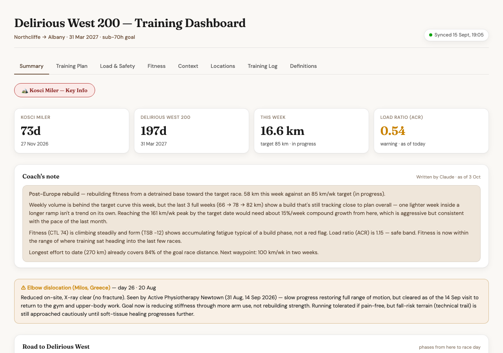
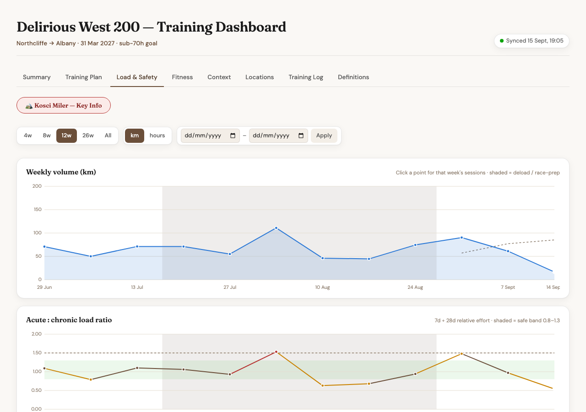
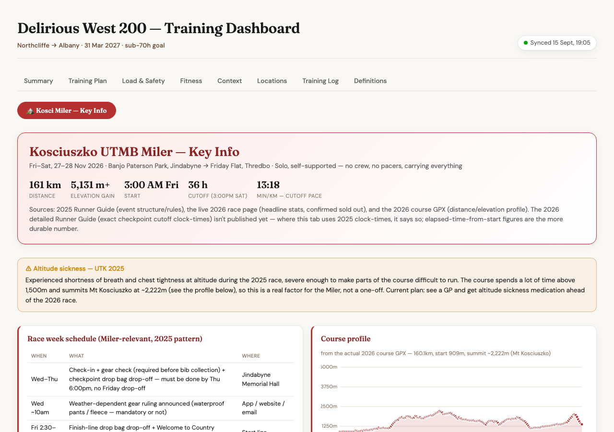
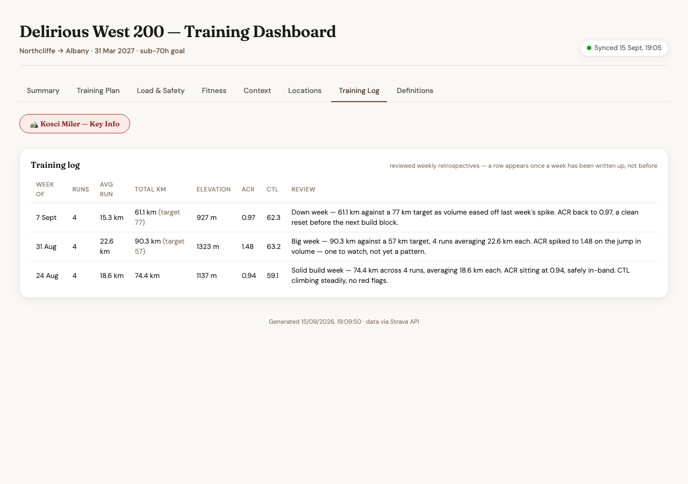
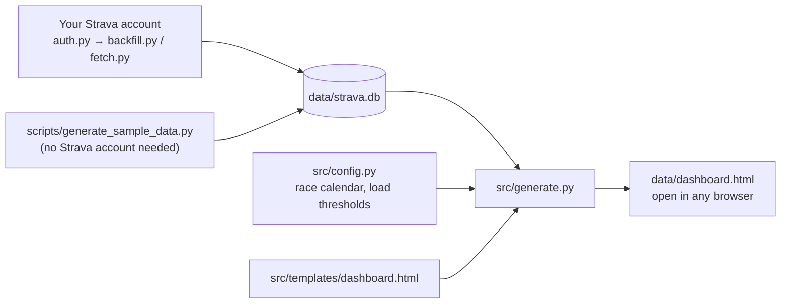

# Strava Ultra Dashboard

A local pipeline that turns your Strava training history into a self-hosted
training dashboard, built for ultramarathon training: load monitoring
(acute:chronic ratio, CTL/ATL/TSB), race-readiness tracking, HR zone
distribution, elevation and pacing trends, and an auto-generated "Coach's
Note" that reads those numbers back to you in plain language.

**[See it live →](https://claude.ai/code/artifact/890ffba1-1a26-458b-862a-697c44d66790)**
— a real, currently-updating example: my own training toward a 200-mile
race in March 2027.






## Why this exists

Strava's own analytics are thin, and third-party training-load tools are
either built for cyclists (power-meter-first) or gate the interesting
metrics behind a subscription. This pulls your full activity history via
the Strava API into a local SQLite database, then generates a single
self-contained HTML dashboard from it — no server, no account, no
recurring cost, and your data never leaves your machine unless you choose
to publish the output somewhere.

Everything here — the local-first pipeline, the SQLite schema, the load
model (ACR, CTL/ATL/TSB), the race-readiness framing, the Coach's Note —
is built around ultramarathon training specifically, because that's my
sport and this is my own dashboard. But none of those *principles* are
running-specific: tracking training load, comparing current fitness
against past efforts, flagging when volume is ramping unsafely, and
surfacing trends instead of raw numbers are useful for any endurance
sport with enough history in Strava — cycling, triathlon, swimming,
rowing, whatever you log there. The pipeline and dashboard mechanics
(fetching, storing, rendering) would carry over largely unchanged; what's
specific to running lives in `src/config.py` (thresholds, zones, race
framing) and parts of `src/generate.py` (the metrics computed from
`sport_type`). Adapting it for another sport means rewriting those parts
around your own sport's numbers, not starting from scratch.

## How it works



Two ways data gets into `strava.db`: your real Strava history (via
`auth.py` once, then `backfill.py`/`fetch.py`), or the synthetic generator
if you're just trying the project out. Either way, `generate.py` reads
whatever's in the database, combines it with the constants in `config.py`
and the HTML template, and writes out one self-contained
`data/dashboard.html` — that's the entire pipeline. Two optional scripts
(`weather.py`, `backfill_locations.py`) enrich the database in the
background but aren't part of the core loop — see
[Project layout](#project-layout) below for what everything does.

## Requirements

- Python 3.12+
- [uv](https://docs.astral.sh/uv/) for dependency management
- A **Strava account with an active subscription**, only if you want to use
  your own data — a paid plan is required to create the API app this
  pipeline authenticates with (more on this below). Not needed for the
  synthetic-data quickstart.

## Try it in 60 seconds (no Strava account needed)

The repo ships a synthetic data generator so you can see the whole thing
work before connecting anything real:

```bash
git clone https://github.com/DylanBai4028/strava-ultra-dashboard.git
cd strava-ultra-dashboard
uv sync
uv run python src/schema.py                    # creates the (empty) database
uv run python scripts/generate_sample_data.py   # fills it with ~15 months of fake training data
uv run python src/generate.py                   # builds data/dashboard.html
open data/dashboard.html
```

That's the whole pipeline. The synthetic data is fabricated — random but
plausible running + weight-training sessions with a realistic
build/step-back weekly pattern — generated fresh each time you run the
script, from a fixed random seed (so it's reproducible, not different
every run). See [docs/schema.md](docs/schema.md) for exactly what it
generates and why.

## Using it with your own Strava data

> **Requires a Strava subscription.** Strava requires a paid subscription
> to create an API application — free accounts can't generate the
> Client ID/Secret this pipeline needs. See
> [Strava's API getting-started guide](https://developers.strava.com/docs/getting-started/)
> for details. (The synthetic-data quickstart above doesn't need this —
> only connecting your own account does.)

1. **Register a Strava API app** — go to
   [strava.com/settings/api](https://www.strava.com/settings/api), create
   an app (any name/website works, "Authorization Callback Domain" should
   be `localhost`). Note the Client ID and Client Secret.
2. **Run the auth flow**:
   ```bash
   uv run python src/auth.py
   ```
   This walks you through Strava's OAuth consent screen in your browser,
   then writes `STRAVA_CLIENT_ID`, `STRAVA_CLIENT_SECRET`, and
   `STRAVA_REFRESH_TOKEN` to a new `.env` file (`chmod 600`, kept out of
   git — see `.env.example` for the format). It'll also ask for an
   optional Gmail App Password, used only to email you if a sync fails.
3. **Initialise the database** (if you haven't already):
   ```bash
   uv run python src/schema.py
   ```
4. **Pull your full history** (one-time; can take a while on a large account):
   ```bash
   uv run python src/backfill.py
   ```
5. **Generate the dashboard**:
   ```bash
   uv run python src/generate.py
   open data/dashboard.html
   ```

For ongoing use, `src/fetch.py` pulls anything new since your last sync
(gear, profile, HR zones, recent activities) — run it before regenerating
the dashboard each time:

```bash
uv run python src/fetch.py
uv run python src/generate.py
```

`src/backfill_locations.py` is a separate, idempotent one-off — it fills
in `location_city`/`location_state`/`location_country`/`location_suburb`
by reverse-geocoding each activity's GPS coordinates in two passes (city,
then suburb), since Strava's API never returns these fields itself. Run
it manually after a sync brings in activities from a genuinely new
region; day-to-day syncing doesn't need it.

## What's in `src/config.py`

Race dates, training phases, past-race results, injury history, and
weekly mileage targets all live in `src/config.py` as plain Python
constants — and they're **mine**, not generic placeholders. I've left
them in as a fully worked example (they're what makes the Coach's Note
and race-readiness panels say anything specific at all), but if you're
running this against your own Strava data, the dashboard will still show
*my* race calendar and targets until you edit those constants yourself.
There's no separate "your data" vs "my config" split — it's one file,
meant to be forked and rewritten for your own race.

The same race-week mechanism that flags a primary goal race (a shaded
band on the mileage chart, a row in the "Coming weeks" table) also
covers secondary races squeezed into a build block — a speed-focused
tune-up race, say, that isn't the main goal but still needs its week
tagged and the mileage target curve adjusted around it. One config date
constant reuses the whole existing rendering path; no separate UI
concept needed.

## The Coach's Note isn't fully automatic — here's what it actually is

The Summary tab's Coach's Note reads like it was written by someone reviewing
your training, because in my own workflow, it periodically is. It's not an
API call baked into the pipeline; it's a manual step in how I refresh my own
dashboard, using Claude Code as the reviewer:

1. `python generate.py --facts` prints a compact JSON summary of your current
   training data — phase, this week's numbers, recent weeks tagged by which
   training phase each one falls in, ramp-check math, race readiness, and so
   on. See `compute_facts_bundle()` in `src/generate.py`.
2. I review that output (in a live Claude Code session) and hand-write a
   short note, saved as `data/coach_note.json`:
   ```json
   {
     "generated_at": "2026-10-03T09:00:00+00:00",
     "based_on": "2026-10-03",
     "html": "<p><strong>Post-Europe rebuild</strong> — rebuilding fitness from a detrained base toward the target race. 58 km this week against an 85 km/wk target (in progress).</p><p>Weekly volume is behind the target curve this week, but the last 3 full weeks (66 → 78 → 82 km) show a build that's still tracking close to plan overall — one lighter week inside a longer ramp isn't a trend on its own. Reaching the 161 km/wk peak by the target date would need about 15%/week compound growth from here, which is aggressive but consistent with the pace of the last month.</p><p>Fitness (CTL 74) is climbing steadily and form (TSB -12) shows accumulating fatigue typical of a build phase, not a red flag. Load ratio (ACR) is 1.15 — safe band. Fitness is now within the range of where training sat heading into the last few races.</p><p>Longest effort to date (270 km) already covers 84% of the goal race distance. Next waypoint: 100 km/wk in two weeks.</p>"
   }
   ```
   (Fabricated numbers, deliberately different from anything shown on the
   live dashboard linked above — this is illustrative, not real data.)
3. `generate.py` embeds that file's content into the dashboard if it exists;
   if it doesn't (which is the case right after you clone this repo and run
   the synthetic-data quickstart), the dashboard falls back to an
   algorithmic version — the same kind of fixed if/else JS template every
   other panel here uses, labeled "Algorithmic draft — not yet reviewed."
   Never a blank panel, just a plainer one.

You can recreate this yourself, with any LLM or by hand — it's just a JSON
file in the shape above. There's no staleness check: whatever's cached shows
indefinitely, dated, until you write a newer one.

## The Training Log tab works the same way, but permanently

The Training Log tab (between Locations and Definitions) is the backward-
looking counterpart: instead of a note that gets rewritten each time
("where things stand now"), it's a diary entry written once per completed
week and never touched again ("how that week actually went").

Same review step covers both. `generate.py --facts` includes an
`unlogged_weeks` list — completed weeks with no log entry yet, each with
everything needed to write one (km, target, elevation, run count, average
distance per run, ACR, CTL, training phase) so there's no need to
cross-reference anything else. A short (1-2 sentence) review for each gets
appended to `data/training_log.json`, a dict keyed by week_start:

```json
{
  "2026-10-12": {
    "generated_at": "2026-10-19T08:00:00+00:00",
    "review": "Down week by design — travel cut volume to 60 km against a 90 km target, but that's exactly what the taper into the qualifying race called for. ACR eased back to 0.95, a clean reset before the next build block."
  }
}
```
(Fabricated, same as the Coach's Note example above — not real data, and not
the same numbers.)

The table's other columns (runs, avg distance, total km, elevation, ACR,
CTL) come live from the same weekly data everything else on the dashboard
uses — only the review sentence is cached. And unlike the Coach's Note,
**there's no algorithmic fallback here**: a week with no cached entry simply
doesn't get a row. No "unreviewed" placeholder, nothing to fall back to —
you just won't see that week until you've actually reviewed it.

## The Kosci Miler tab is a worked example of a race-specific deep dive

Most of the dashboard is generic — it'd work for any race, any sport. The
**🏔 Kosci Miler — Key Info** tab is the opposite: a one-off reference page
built from the actual race documents for one specific event I'm running
(checkpoints and cutoffs, mandatory gear, drop-bag logistics, an elevation
profile plotted from the real course GPX, a safety/emergency-contact
section). It's static content, not computed from Strava data, and it's
deliberately styled apart from the rest of the dashboard — its own nav
row, race-branded accent colour — so it reads as "reference doc," not
another metrics panel.

It's left in as an example of the other kind of thing this approach is
good for: once you've got a self-contained HTML dashboard and an LLM
that can read a PDF runner's guide and a GPX file, building a tab like
this for your own goal race is a small step, not a new project. The
content itself won't mean anything if you're not running the Kosciuszko
UTMB Miler — treat it as a template to gut and refill with your own
race's key info, or delete the tab entirely if you don't want it.

## Data model

See [docs/schema.md](docs/schema.md) for the full table-by-table
breakdown of `data/strava.db` — what each table holds and how they relate.

## Project layout

```
src/
  auth.py               one-time OAuth setup
  schema.py             creates/migrates the SQLite database
  backfill.py            one-time full-history pull
  backfill_locations.py  one-off reverse-geocoding pass (city/suburb)
  fetch.py               incremental sync — new activities, gear, zones
  weather.py              backfills temperature Strava didn't record
  generate.py             builds data/dashboard.html from the database
  config.py               race calendar, targets, thresholds (see above)
  utils.py                shared helpers, failure-notification email
  templates/dashboard.html  the Jinja2 dashboard template
scripts/
  generate_sample_data.py  synthetic data generator (see Quickstart)
docs/
  schema.md                data model reference
data/                       gitignored — your database and generated dashboard live here
```

## Built with Claude Code

This started from curiosity, not a plan. I learned Claude could connect
to Strava's API and got curious what would actually happen if I pointed
it at years of my own training data — what could AI and personal data
uncover together, and could I build something out of it that was
genuinely useful, not just a novelty. One question turned into a real
project: the pipeline, the schema design, the load-monitoring model, the
dashboard itself, and the analysis behind what to visualise and how were
all built by vibe-coding with [Claude Code](https://claude.com/claude-code)
— I described what I wanted, reviewed and directed every change over a
series of sessions, and Claude wrote the large majority of the code and
did the data analysis behind most of the design decisions. It's turned
into one of the most fun things I've built, and if it nudges anyone else
to point Claude at their own Strava data and see what comes out, that'd
make me pretty happy.

I welcome all feedback — good, bad, "this chart doesn't make sense,"
"you're missing an obvious metric," whatever. The goal is for this
dashboard to keep getting more useful over time, and the fastest way
there is hearing what isn't working. Open an issue or a PR.

### How I run it day to day

None of this is required to use the project — `generate.py` produces a
complete, self-contained `dashboard.html` you can open directly or host
anywhere that serves static files. This is just how *I* run it, also via
Claude Code:

- **Refreshing:** two shell aliases, `strava-sync` (runs `fetch.py`) and
  `strava-dashboard` (runs `generate.py` and opens the result), chain the
  two steps I'd otherwise type by hand.
- **Publishing:** I keep a live copy of my own dashboard published as a
  [Claude Artifact](https://claude.ai/code/artifact/890ffba1-1a26-458b-862a-697c44d66790)
  so I can check it from my phone without a server. A third alias,
  `strava-publish`, runs the sync + regenerate steps and copies a
  ready-to-send prompt to my clipboard — I paste it into a Claude Code
  session and it republishes the Artifact at the same URL. The paste step
  can't be fully automated away: Claude Code's non-interactive mode
  (`claude -p`) can publish Artifacts, but caps them at 256KB, and my
  dashboard runs larger than that (mostly embedded fonts and data) — only
  an interactive session can publish something that size. So the
  automation gets everything ready in one command; only the last "hit
  enter" step is manual.

This is a personal convenience layer, not something the pipeline depends
on — if you're running this yourself, `generate.py` → `open
data/dashboard.html` is the whole loop.

## License

[MIT](LICENSE) — do whatever you'd like with this.
